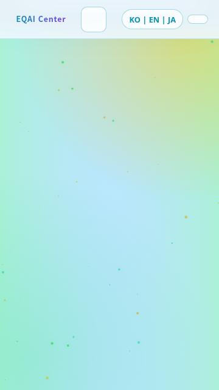
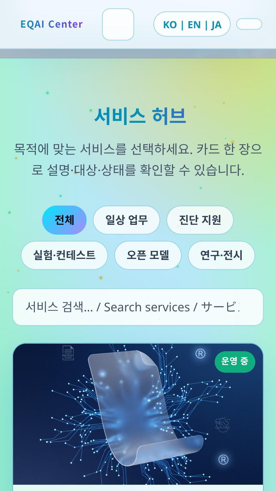

# Mobile service visibility review

Reviewed on 2026-10-22. Baseline: main `bd168dff760b9e4eb76f85439a4887286c1805d8` (see exact SHA in [baseline.json](baseline.json)); `index.html` Git blob `fae917969cdf45c3bee92227055aa4a9c8e53d2e`. Runtime: Node v24.19.0, Playwright 1.62.1, headless Chromium 154.0.8037.57 on Linux. Pixel 5 emulation uses a mobile user agent, touch, scale factor and mobile viewport; it is not Android Chrome on a device or an Android emulator. No Android emulator, adb device or Samsung Internet was available.

## Observed failure before the fix

No source, visibility classes or opacity were changed during reproduction. A thin wrapper logged native IntersectionObserver entries and passed them unchanged to the original callback. The regression test also failed against the original HTML without any observer wrapper. External presentation-only fonts/icons received empty CSS responses; local HTML, inline JS and images were unchanged.

| Scenario | Viewport | Service section height | Grid columns | Stable state after “Start Services” |
| --- | --- | --- | --- | --- |
| Desktop | 1440×1000 | 2717.03px | 3 | `.visible`, opacity approaches 1 during transition |
| Viewport only | 360×640 | 6880.91px | 1 | no `.visible`, opacity 0, translateY(28px) |
| Pixel 5 emulation | 390×844 | 7063.39px | 1 | no `.visible`, opacity 0, translateY(28px) |
| Pixel 5 landscape | 844×390 | 4071.66px | 2 | no `.visible`, opacity 0, translateY(28px) |

All four runs rendered 15 service cards and 3 research cards in the DOM; no application JavaScript exception occurred. The initial 360×640 services entry was `isIntersecting: false`, `intersectionRatio: 0`. No later services callback was delivered during navigation/full-list scrolling. At the stable anchor the geometric intersection ratio was 0.08198, while opacity remained 0. Even the geometric maximum 640 / 6880.91 is only 0.09301. The 390×844 case likewise stayed transparent (its maximum is about 0.11949). The desktop's next services entry was `isIntersecting: true`, ratio 0.14648, and its callback added `.visible`.

This is a recorded Chromium behavior, not an inference based only on `threshold: 0.12`, nor a claim that every browser implements threshold/isIntersecting identically. The demonstrated code defect is that content starts transparent and depends on an observer callback on a tall section to become readable. Cards exist, but their ancestor stays transparent. Hit testing still reaches transparent links; DOM count and Playwright `isVisible()` alone do not establish readable content.

[Raw evidence](baseline.json) includes viewport and section geometry, computed display/visibility/opacity/transform, classes, grid tracks, overlay samples, native observer timestamps/root/target bounds, language/theme storage, errors and failed requests. Fast scroll samples may include transient research reveal delays; the table uses settled services-anchor states. Fresh and returning local-context visits both reproduced the service problem; local service-worker registrations were empty and controller was null.

## Change and verification

- `index.html`: sections are readable by default; remove section fade/translate and observer initialization. Header animations remain. Filtering via `.is-hidden` is unchanged.
- A separate, injected canvas failure exposed optional background initialization interrupting saved-theme restoration and, on a thrown `getContext`, a later theme-toggle error. The patch catches only context-acquisition failure, skips canvas resizing/drawing without a context and avoids scheduling animation frames in that case. This is robustness work, not a second claimed cause of the original normal-motion failure.
- The service/research data arrays are byte-for-byte unchanged: all contents, URLs, images, IDs, orders and the cases → marie-control → skill-archive → quality sequence remain.
- [Regression test](../../../tests/mobile-visibility.cjs): normal-motion first visits, CTA, scrolling every card with ancestor-opacity and hit checks, all image decodes, four viewport configurations × three languages × two themes (24 combinations), filters/search/empty state, hash visits and reload, history, portrait/landscape resize, second-tab return, keyboard/new-tab activation and mobile navigation.
- Separate reduced-motion, observer missing/constructor failure/no callback, and null/throwing canvas robustness cases. Assertions are not weakened for injected errors: the final implementation should produce none.
- Runtime JS/console errors and local request failures are checked. All inline scripts pass syntax validation; `git diff --check` passes. Baseline regression exits nonzero on `#services` opacity 0, demonstrating that it can catch the original failure.

See [validation.log](validation.log) for the final run's actual outcomes.

## Live site / HTTP / cache limits

Requests to both `http://eqai.moip.ai.kr/` and `https://eqai.moip.ai.kr/` were blocked with 403 through the cloud proxy. Final URLs, deployed HTML/JS/image responses and HTTP→HTTPS redirect behavior could not be verified. GitHub Pages API reports `html_url: http://eqai.moip.ai.kr/`, `https_enforced: false`, `status: built` and CNAME `eqai.moip.ai.kr`; these settings do not prove the runtime redirect behavior. No HTTPS, cache, CNAME, service-worker or deployment changes are made.

The checked main HTML has no service-worker registration. Empty registrations in a fresh local origin do not establish absence of an older worker on a user's production origin. Existing production cache/worker state and physical Android/Samsung Internet behavior remain unverified. A headless tab return check is not an Android OS background/resume test. New-tab destinations are intercepted for testing; external services are not exercised.

## Screenshots

These are actual page screenshots, including headings, filters/search and cards, captured with normal motion and no visibility overrides. Width×height in filenames are CSS viewport pixels; mobile device scaling increases image pixel dimensions. External font/icon CSS was stubbed, so navigation icon glyphs are absent.

| Before, 360×640 KO light | After, 360×640 KO light |
| --- | --- |
|  |  |

Other views: [390×844 before](before-390x844.jpg), [360×640 KO dark](after-360x640-ko-dark.jpg), [390×844 EN dark](after-390x844-en-dark.jpg), [390×844 EN light](after-390x844-en-light.jpg), [1440×1000 JA dark](after-1440x1000-ja-dark.jpg), [1440×1000 JA light](after-1440x1000-ja-light.jpg).

The [390×1600 KO dark view](after-390x1600-ko-dark.jpg) is an additional tall viewport screenshot showing the heading, search and multiple cards together; it is not presented as a 390×844 phone screenshot.
